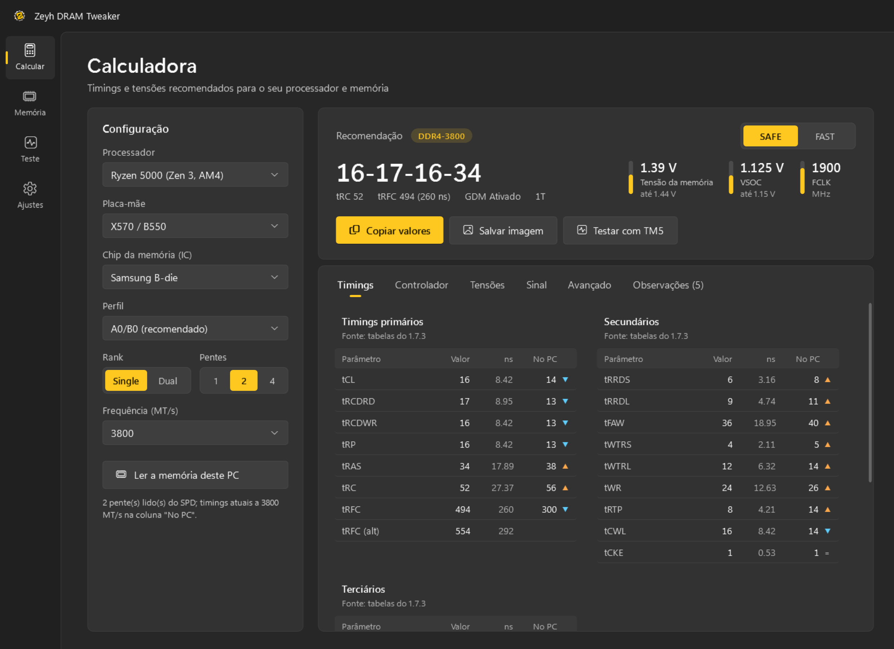
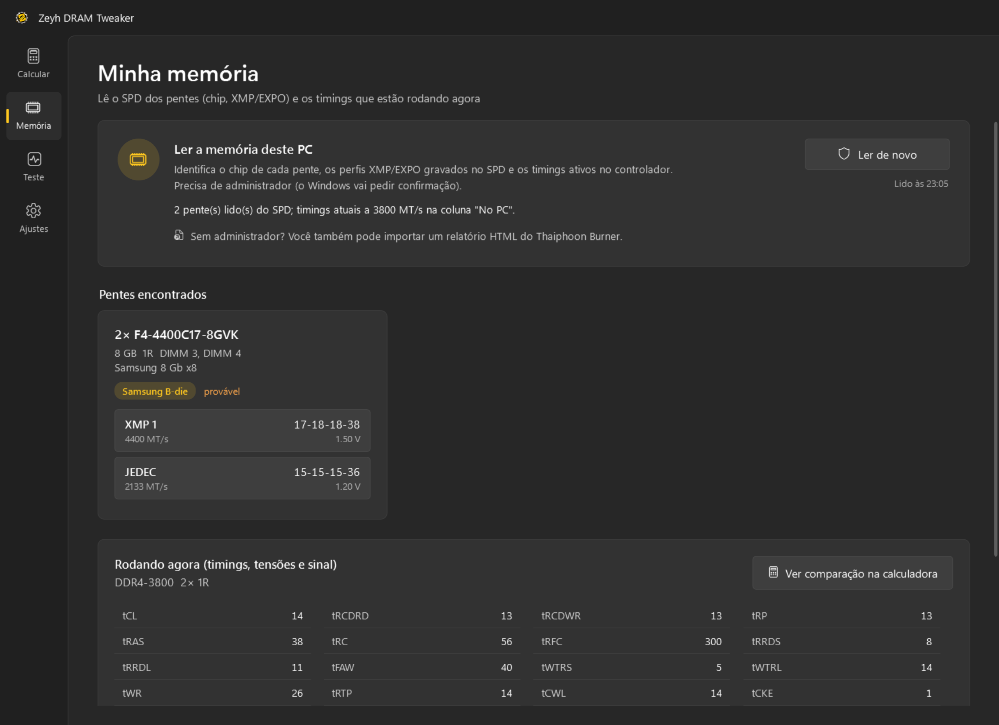
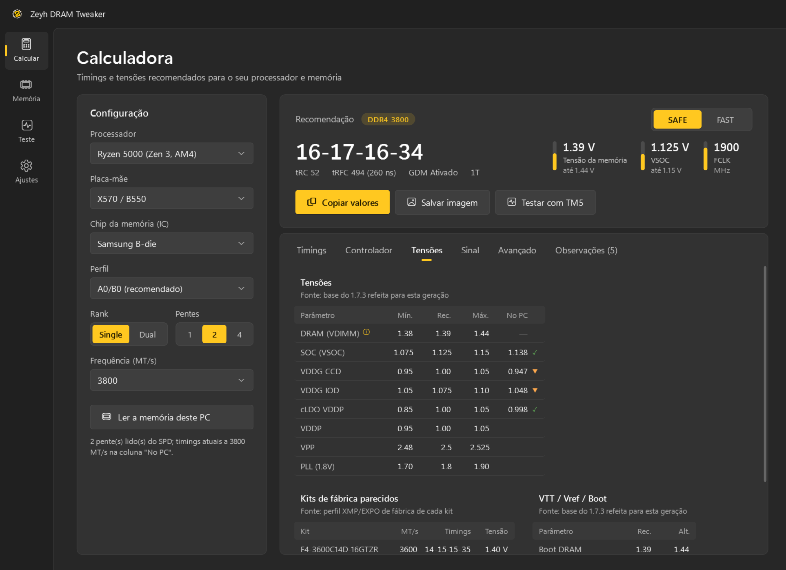
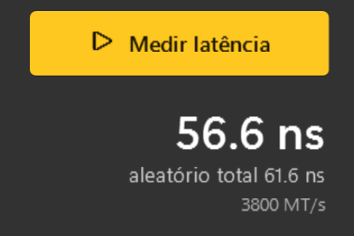

# Zeyh DRAM Tweaker

Calculadora de timings e tensões de RAM para Ryzen, do Zen 1 ao Zen 5, DDR4 e DDR5. Ela lê a memória do seu PC, compara o que está rodando com o recomendado, mede a latência em nanossegundos e já traz o TestMem5 para testar a estabilidade.

Grátis e de código aberto (GPL-3.0). Interface em português e inglês.



*[English below](#english)*

## O que ele faz

- **Calcula timings e tensões** para Ryzen 1000 a 9000 (AM4 e AM5), DDR4 e DDR5, com perfis SAFE e FAST.
- **Lê a memória do PC**: o chip de cada pente (B-die, Hynix, Micron...), os perfis XMP/EXPO gravados no SPD e os timings que o controlador está usando agora.
- **Compara lado a lado**: a coluna "No PC" mostra o valor atual ao lado de cada recomendação, com setas para o que está mais apertado ou mais folgado.
- **Tensão com começo e limite**: diz por onde começar e até onde subir se o teste der erro. Calibrada com kits G.Skill de fábrica.
- **Mede a latência da RAM em ns**, com o mesmo método do AIDA64 (leituras aleatórias em blocos). Também mostra o pior caso, igual ao modo "Full Random" do AIDA.
- **TestMem5 embutido** com os configs do anta777. O resultado aparece no app quando o teste termina.
- **Copia os valores** em texto ou **salva uma imagem** com todas as tabelas, para mandar no Discord ou no WhatsApp.

<p>
  
  
</p>
<p></p>

## Download

Baixe o `.zip` da versão mais nova na aba **[Releases](../../releases)**, extraia e abra o `ZeyhDramTweaker.exe`. Não precisa instalar nada além disso para usar a calculadora.

**Requisitos**
- Windows 10 ou 11, 64 bits.
- Processador AMD Ryzen para ler a memória do PC. A calculadora funciona em qualquer PC.
- Para **ler a memória do PC**, o app usa o [PawnIO](https://pawnio.eu), um driver gratuito e assinado, e pede administrador. Sem ele, todo o resto funciona.

O Windows pode mostrar o aviso do SmartScreen na primeira vez, porque o executável não tem assinatura paga. O `.exe` de cada Release é compilado pelo próprio GitHub (veja a aba Actions) a partir deste código, e o hash SHA-256 vai junto.

## Como usar

1. Na aba **Memória**, clique em **Ler memória do PC**. O app identifica os pentes e os timings atuais.
2. Escolha um perfil XMP/EXPO do seu pente, ou escolha o perfil na **Calculadora**.
3. Passe os valores para a BIOS, comece pela tensão indicada e teste com o **TestMem5** na aba **Testes**. Deu erro? Suba a tensão 0.01 V por vez até o máximo indicado, ou afrouxe um passo em tCL, tRCD ou tRFC.
4. Meça a latência antes e depois para ver o ganho.

> **Aviso:** mexer em timings e tensões é por sua conta e risco. Sempre teste a estabilidade antes de usar no dia a dia. As recomendações são um ponto de partida, e o resultado varia com o pente, a placa-mãe e o processador. DDR5 ainda está em beta (não foi testado em hardware AM5 real).

## Créditos

- **Ryzen DRAM Calculator 1.7.3, de 1usmus.** As tabelas DDR4 e a fórmula do perfil Manual reproduzem o comportamento dele, obtidas por engenharia reversa. Nenhum código original está incluído. Zen 3, DDR5, as tensões, a leitura do PC, a latência e a interface são novos.
- **TestMem5**, de Serj (freeware), com configs de anta777, 1usmus, LMHz e Serj, distribuídos sem alteração.
- **PawnIO**, de namazso. Os módulos AMDFamily17, SmbusPIIX4 e RyzenSMU são LGPL-2.1.
- Tensões calibradas com os perfis XMP/EXPO de fábrica de kits G.Skill.

Detalhes em [`src/ZeyhDramTweaker.Core/Data/THIRD-PARTY.txt`](src/ZeyhDramTweaker.Core/Data/THIRD-PARTY.txt).

## Compilar

Precisa do [.NET 9 SDK](https://dotnet.microsoft.com/download/dotnet/9.0).

```bash
dotnet build ZeyhDramTweaker.sln -c Release
dotnet publish src/ZeyhDramTweaker -c Release -r win-x64 --self-contained true -p:PublishSingleFile=true -p:IncludeNativeLibrariesForSelfExtract=true -p:EnableCompressionInSingleFile=true -o publish
```

`tests/ZeyhDramTweaker.Verify` confere as regras do app. A parte que compara com o 1.7.3 original precisa das execuções gravadas do programa original, que não fazem parte deste repositório; sem elas, essa parte é pulada.

## Licença

[GPL-3.0](LICENSE). Pode usar, estudar, modificar e redistribuir, desde que a versão redistribuída continue com o código aberto e com os créditos.

---

## English

Zeyh DRAM Tweaker is a RAM timing and voltage calculator for AMD Ryzen, Zen 1 to Zen 5, DDR4 and DDR5. It reads the memory in your PC (chip, XMP/EXPO, timings running now), shows them next to the recommendation, measures memory latency in ns with AIDA64's method (block-random reads, plus the full-random worst case), and ships TestMem5 with anta777's configs.

- Download the latest `.zip` from **[Releases](../../releases)**. Windows 10/11 x64.
- Reading the PC's memory needs the free, signed [PawnIO](https://pawnio.eu) driver and administrator rights. Everything else works without it.
- DDR4 tables and the Manual formula reproduce Ryzen DRAM Calculator 1.7.3 by 1usmus (reverse engineered, no original code included). DDR5 is beta.
- Changing timings and voltages is at your own risk. Always test stability.
- License: GPL-3.0.
